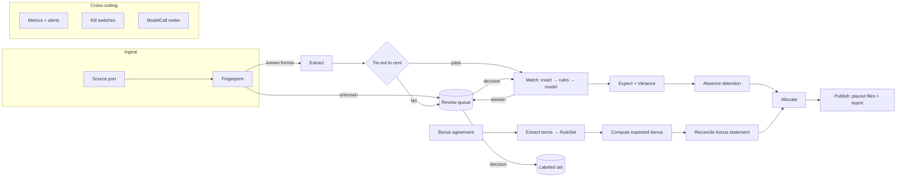

# Payout Verification for Agency Networks: Design Doc

Status: Draft v0.3, 2026-10-30. Milestones 1, 2, 3, 7 and 9 implemented, 6 started, with a local admin; see the README for what runs today. Author: Jose Guillen.
Reviewers: AlphaX engineering (architecture review).

---

## 1. Context

Affordable American Insurance (AAI) is a P&C agency network: about 100 independent agencies in 40
states, 50+ carrier appointments, 20+ carrier profit-sharing programs, EZLynx as the agency
management system (AMS). AAI's value to its agencies is carrier access and better economics:
"enhanced commission" and "profit-sharing."

That means AAI's finance team has to answer one question each month, for every carrier and every
agency: **did we get paid what we were owed, and did we pay each agency its share?**

Today the inputs to that answer arrive as:

- **Commission statements.** Each carrier sends one per period in its own format (CSV, XLSX, PDF,
  portal export), with its own column names, policy number conventions, transaction codes and
  reversal semantics.
- **Profit-sharing (contingent bonus) statements.** These come once or a few times a year. Each
  is governed by a bespoke agreement with thresholds, growth tiers, loss-ratio bands and
  eligibility rules.
- **The policy book.** This is the system of record, an AMS export: policy, carrier, line of
  business, effective date, premium, agency, producer.
- **Rate cards and split tables.** These say what each carrier should pay by line and new vs
  renewal, and what share each agency gets.

Vendors (Applied Recon, Vertafore's Reconciliation Agent, Ascend) sell statement-to-AMS matching
for a single agency. This system sits one level up, at the network. It verifies carrier payments
against expected amounts, verifies contingent bonuses against the agreement terms, and allocates
to agencies. No vendor covers the bonus verification at all.

## 2. Goals and non-goals

### Goals

1. **Verify carrier commission payments.** For each carrier statement, produce a matched,
   variance-coded reconciliation against the policy book and rate card.
2. **Verify profit-sharing payments.** For each bonus program, extract the agreement terms into
   rules, compute the expected bonus, and reconcile it against the carrier's bonus statement.
3. **Allocate to agencies.** Produce a per-agency payout file in which every cent traces back to
   source lines.
4. **Keep humans in charge of anything uncertain.** Low-confidence items go to a review queue with
   evidence. Human decisions are recorded and feed the eval set.
5. **Detect when it stops working or quietly regresses,** per counterparty, before money moves.
6. **Onboard a new counterparty or a new tenant through config and labeled examples, not code.**
7. **Run the same codebase in two profiles:** `demo`, which is fully local, deterministic and
   needs no secrets, and `prod`, which uses real infrastructure adapters.

### Non-goals (v1)

- Moving money. The output is a payout file and a report. Payment execution stays in AAI's
  accounting system.
- Replacing the AMS or writing back into EZLynx. The system reads from the AMS; a writer adapter
  is a later step.
- OCR of scanned images. v1 handles text PDFs; scanned input is rejected to the review queue.
- Real-time processing. This is a periodic batch close, and latency is measured in minutes.
- A general-purpose UI. There is one review page and file outputs.
- Multi-user auth and roles beyond a single operator identity in the demo.

## 3. Assumptions and open questions

| #   | Assumption                                                                    | If wrong                                                                                                                                                                                                                           |
| --- | ----------------------------------------------------------------------------- | ---------------------------------------------------------------------------------------------------------------------------------------------------------------------------------------------------------------------------------- |
| A1  | Carriers remit commission to AAI centrally, and AAI pays agencies.            | The statement stage still verifies the agency-level statements AAI collects. The allocation stage becomes override settlement instead. The bonus stage is unchanged. The design holds either way; only the stage emphasis changes. |
| A2  | AAI holds or can obtain an AMS policy export per agency.                      | We need a per-agency AMS adapter. The port already exists (section 6.2).                                                                                                                                                           |
| A3  | Rate cards and bonus agreements are available as documents AAI already holds. | The bonus stage needs the agreement terms entered by hand. The extraction step becomes optional.                                                                                                                                   |
| A4  | No accounting-automation vendor is already in place.                          | Scope narrows to bonus verification and allocation, positioned above the vendor.                                                                                                                                                   |

Open questions for AAI are tracked in `case-study-decision.md` section 5.

## 4. Requirements

### Functional

- **F1. Ingest** statements from a source location. Any one statement is processed once,
  whatever duplicates arrive.
- **F2. Identify** the counterparty and format of each statement by fingerprint, not by filename.
- **F3. Extract** lines to a canonical schema, with field-level confidence and a pointer to the
  source location of each value (page, row).
- **F4. Tie out.** The sum of extracted lines must equal the statement's stated total to the
  cent, or the statement is held.
- **F5. Match** each line to a policy: deterministically first, then model-assisted for the
  residue, with abstention below a threshold.
- **F6. Compute** the expected amount from effective-dated rate rules. Classify each variance by
  reason code.
- **F7. Detect absences:** policies due for commission in the period with no line on any
  statement.
- **F8. Extract** bonus agreement terms into a typed rule set. Compute the expected bonus and
  reconcile it.
- **F9. Allocate** to agencies via effective-dated split rules. Emit a payout file.
- **F10. Run a review queue** with accept, override, reassign and hold actions. Every action is
  audited and exported as a labeled example.
- **F11. Provide a kill switch** per counterparty and per tenant.

### Non-functional

- **Correctness over automation.** A wrong auto-match is worse than an exception. The system is
  biased toward abstaining.
- **Determinism.** Given the same inputs, configs and recorded model responses, a run produces
  identical outputs. Money math never touches the model.
- **Auditability.** Every output figure links to its source line, the rule version and the
  decision (code, model or human) that produced it. Runs are immutable.
- **Idempotency.** Every stage can be re-run safely, and re-running a period produces a new run
  rather than mutating the old one.
- **Isolation.** Tenants never share rows, configs or model context.
- **Cost visibility.** Every model call is metered: tokens, cost, latency, stage, counterparty.
- **Operability.** One command starts the demo. Every alert has a named owner and an action in
  the runbook.

## 5. Domain model

```
Tenant ─┬─ Counterparty (carrier | retailer | payer) ── SourceFormat (fingerprint, mapping, version)
        ├─ RecordSet (system of record: policies | invoices)
        ├─ RateRule (counterparty, product, new/renewal, rate, effective_from/to)
        ├─ SplitRule (agency, product, share, effective_from/to)
        └─ BonusProgram ── BonusAgreement (document) ── BonusRuleSet (extracted, versioned)

Run (tenant, period, profile, config_hash, status)
 └─ Statement (counterparty, format, period, stated_total, status: received|held|extracted|tied|matched|closed)
     └─ StatementLine (raw, canonical fields, confidence, source_ref)
         └─ Match (line → record, method: exact|rule|model|human, score, reasoning)
             └─ Expectation (expected_cents, rule_id@version)
                 └─ Variance (delta_cents, reason_code)

ReviewItem (subject, reason, evidence, status) ── Decision (actor, action, before/after, ts)
Allocation (agency, source lines, amount_cents) ── PayoutFile (run, agency, total, checksum)
ModelCall (stage, model, prompt_version, tokens, cost, latency, cache_hit)
```

Money is stored as integer cents (`bigint`). Rates are stored as basis points or exact decimal
strings and are never floats.

## 6. Architecture

### 6.1 Shape: a modular monolith running a staged batch pipeline



Each stage:

- reads its inputs from Postgres and writes its outputs to Postgres in one transaction;
- is keyed by `(run_id, statement_id, stage)`, which makes it idempotent;
- is scheduled as a job on a Postgres-backed queue (pg-boss), so retries, backoff and
  concurrency limits per counterparty come from one place;
- checks the kill switch before doing work.

**Today** the stages run in one process per command (`reconcile`, `bonus`), reading and writing
files, and the kill switch is checked before a statement is read. The stage boundaries are the same;
persisting them as jobs is milestone 4 (section 18).

**Why a monolith.** One team, one deploy, one database, transactional consistency between stages.
Services would add network failure modes and buy nothing at this volume: hundreds of statements a
month. The stage boundaries are the seams to split along later if volume demands it.

**Why batch.** The business process is a periodic close. A batch run gives an immutable, auditable
unit (`Run`) that can be diffed against the previous run.

### 6.2 Ports and adapters: one codebase, two profiles

All I/O goes through interfaces. The profile selects the adapters at startup, so the domain code
cannot tell demo from prod.

| Port                                    | Demo adapter                                                                                                                            | Prod adapter                                       |
| --------------------------------------- | --------------------------------------------------------------------------------------------------------------------------------------- | -------------------------------------------------- |
| `SourceStore` (where statements arrive) | Local folder watcher (`./inbox`)                                                                                                        | S3 bucket with event notification, or IMAP mailbox |
| `RecordStore` (system of record)        | CSV policy book written by the generator (Postgres from milestone 4)                                                                    | EZLynx export via SFTP or API, nightly snapshot    |
| `ModelClient`                           | Claude API with a **record/replay cassette**: live when a key is present and records responses; replays recorded responses when offline | Claude API, with retries, timeouts, budget guard   |
| `Clock`                                 | Fixed or controllable clock (period close on demand)                                                                                    | System clock                                       |
| `Notifier`                              | Console, the admin's overview banners and its monthly signals                                                                           | Slack or PagerDuty, routed by alert owner          |
| `BlobStore` (originals, outputs)        | Local `./data`                                                                                                                          | S3 with object lock for originals                  |
| `SecretStore`                           | `.env` (no secrets needed in replay mode)                                                                                               | Cloud secrets manager                              |
| `Publisher` (payout files)              | `./out/<run>/`                                                                                                                          | S3 plus an accounting-system import drop           |

**The demo is production code where it matters.** The money rules, the extraction, the model client
and the evals are what production runs. What differs today: the file adapters are wired in directly,
not chosen by a profile, and there are no migrations, job queue or contract tests yet. Those come
with milestones 4 and 8, and the target stays the one in this table: the same stages and evals in
both profiles, only adapters differing, each adapter passing one contract test in both forms.

Record/replay makes the Loom deterministic and lets a reviewer run the demo without an API key.
Today CI replays the evals on every push, and live runs are by hand (`MODEL_MODE=live pnpm eval`).
A scheduled live run is part of milestone 5.

### 6.3 Where the model is used, and where it is not

| Step                                         | Model?    | Why                                                                                                                     |
| -------------------------------------------- | --------- | ----------------------------------------------------------------------------------------------------------------------- |
| Format fingerprint                           | No        | Header hash plus column set plus page layout signature. Deterministic, and drift detection depends on it.               |
| CSV and XLSX extraction for a known format   | No        | A versioned column mapping in config.                                                                                   |
| Mapping proposal for a new or drifted format | Yes       | Proposes a column mapping; a human approves it and it becomes config. The model never maps silently in a run.           |
| PDF table extraction                         | Yes       | PDF goes directly to the model with a strict tool schema. The output must pass tie-out.                                 |
| Matching, exact and rules                    | No        | Normalized policy number, insured name plus effective date, premium tolerance.                                          |
| Matching, residue                            | Yes       | Ranks candidate policies, returns a score and reasoning. Abstains below the floor. Never sees money totals.             |
| Expected amounts, variances, allocation      | **Never** | Pure functions over integer cents and versioned rules.                                                                  |
| Bonus agreement to rule set                  | Yes       | Extracts to a closed typed schema (thresholds, tiers, bands, eligibility). A human approves each rule-set version once. |
| Bonus computation                            | **Never** | A deterministic evaluator over the approved rule set.                                                                   |

Model outputs use structured outputs against closed schemas, with no free-form maps. Every call
records its prompt version, model ID, tokens, cost and latency. The model is configurable per
stage.

**Model choice.** Reading a statement is transcription, not reasoning, and every reading is checked
by code before it can reach a payout. So the default is a mid-tier model (Sonnet), not the largest
one. A reading that fails its checks (it does not tie out, or a line cannot be parsed) is retried
once on a stronger model (Opus) before the statement is held for a person. Most statements are read
at the lower price, and only the hard ones pay for the stronger model. The eval runs on either model
and is what decides the default: a cheaper model is adopted only if it meets the same floors.

### 6.4 Data flow for one statement

1. A file lands in `SourceStore`. The original is stored immutably with a content hash; a
   duplicate hash is a no-op.
2. **Fingerprint** matches a known `SourceFormat@version`. A new header set or a confidence drop
   holds the statement and opens a review item with a model-proposed mapping.
3. **Extract** produces lines with a `source_ref` and per-field confidence.
4. **Tie-out**: the sum of lines must equal the stated total, or the statement is held. This
   single check catches most extraction errors.
5. **Match** runs exact, then rules, then the model on the residue. The method mix is recorded
   for each statement.
6. **Expect** computes expected cents from the effective-dated rate rule. Variances get reason
   codes: `RATE`, `PREMIUM`, `PERIOD`, `DUPLICATE`, `REVERSAL`, `UNKNOWN`.
7. **Absence**: policies due in the period with no line become `MISSING_COMMISSION` items.
8. **Allocate** writes an allocation per agency per line.
9. **Publish**: the payout file per agency plus the run report. Publishing is blocked while
   blocking review items remain open, unless an operator overrides with a reason.

### 6.5 Bonus verification

1. **Agreement to rules.** The model reads the agreement PDF into a closed schema: eligible lines,
   minimum premium, loss ratio bands with rates, and the cap, each with its clause number. Terms the
   schema cannot express (forfeiture, valuation dates, offsets) come back as notes for the reviewer
   instead of being dropped or forced into a field. Code converts the text to cents and basis points
   and rejects a wrong year, unknown products or bands out of order.
2. **Approval.** A person checks each rule against its clause and saves it as the program's
   `rules.yaml`. The rules carry the agreement's SHA-256, so a changed document stops the run and asks
   for a new approval instead of applying old terms to new text.
3. **Expected bonus.** Code applies the rules to the network's own production records. Earned premium
   and incurred losses come from the carrier, since only the carrier has them; the report says so.
   Every step of the calculation cites its clause.
4. **Statement check.** The carrier's statement must tie out across agencies. Each agency's premium is
   compared with the network's records, the loss ratio is recomputed from the carrier's own totals,
   and the rate is checked against the band. Underpaid is a dispute, overpaid is a review, and each
   finding names its clause.
5. **Split.** What was actually paid is split: the network keeps its share and the rest goes to
   agencies by eligible premium, largest remainder, so the shares add up to the cent. A recovered
   underpayment is split the same way when it arrives.
6. **Dispute letter.** An underpayment gets a draft letter filled from a template, quoting the
   clauses, the carrier's figures and ours. A model does not write it: figures sent to a carrier must
   be exact.

Growth tiers (a rate that depends on premium growth over the prior year) are common in real
agreements and are the next rule type to add; the demo agreement has none.

## 7. Correctness controls

- **Tie-out to the cent** at the statement level and again at run level: total in equals total
  allocated plus retained plus held.
- **Integer cents, effective-dated rules, and a config hash** recorded on every run.
- **Immutable runs.** Re-processing creates a new run, and `run diff` shows what changed and why.
- **Abstention floor** on every model-assisted decision, tuned against the eval set and versioned
  with it.
- **Sampled audit.** A random 5% of auto-matched lines are routed to review. This catches the
  confident false match that the exception queue never sees.
- **Four-eyes on config.** New format mappings and new bonus rule sets need explicit approval
  before they take effect.

## 8. Human in the loop

**Today** a person decides one kind of item, in the admin: a proposed mapping for a changed layout,
or bonus rules read from an agreement. Approving writes the config with the reviewer's name and
appends to `approvals.jsonl`; held lines are listed for a person but decided outside the tool. The
queue below needs stored runs and is milestone 4.

The review queue is one table plus one page in the admin. Each item shows the source excerpt,
the candidate decision, the model's reasoning and confidence, and the rule involved. The
available actions are accept, override (choose a record or amount), hold and reassign.

Every decision:

- is written to an append-only audit log;
- unblocks the downstream stage for that item;
- is exported as a labeled example with its source, so overrides become regression tests.

**Override rate per counterparty is the production accuracy signal.** Production has no labels,
and human decisions are the only labels production generates.

## 9. Observability, regression detection, kill switches

There are two different failures to detect:

- **Stopped:** the pipeline errors. This is easy, and any job monitor catches it.
- **Regressed:** the pipeline runs and is quietly wrong. This is the one that costs money, and
  most of the design is aimed at it.

| Signal                                          | Detects                                                | Threshold (initial, tuned with ops)            | Action                                                | Owner       |
| ----------------------------------------------- | ------------------------------------------------------ | ---------------------------------------------- | ----------------------------------------------------- | ----------- |
| New or changed header fingerprint               | Format drift                                           | Any                                            | Hold that counterparty's statement, propose a mapping | Finance ops |
| Extraction confidence distribution per format   | Silent extraction decay                                | p10 drops more than 0.1 vs trailing 3 runs     | Hold, alert                                           | Engineering |
| Tie-out failure                                 | Extraction error                                       | Any                                            | Hold statement                                        | Finance ops |
| Line count vs trailing average                  | Truncated or duplicated input                          | More than ±40%                                 | Warn, require ack to publish                          | Finance ops |
| Match method mix (exact, rules, model, abstain) | Upstream ID format change, model drift                 | Model share up more than 15 pts                | Alert                                                 | Engineering |
| Exception share per counterparty                | Both over- and under-matching                          | Outside the control band, **either direction** | Alert                                                 | Engineering |
| Unexplained variance $ per counterparty         | Real underpayment or a logic bug                       | Control chart, 3σ                              | Alert, attach top lines                               | Finance ops |
| Silent counterparty                             | Missing statement                                      | No statement by cadence plus 5 days            | Alert                                                 | Finance ops |
| Override rate per counterparty                  | Production accuracy decay                              | More than 2x trailing                          | Alert, add the overrides to the eval set              | Engineering |
| Golden replay (canary)                          | Model or provider regression, separate from data drift | Any diff vs expected                           | Fail the run's health check                           | Engineering |
| Escalation rate per counterparty                | A layout the default model struggles with, model drift | More than 2x trailing                          | Alert; review the reading notes for that format       | Engineering |
| Model cost per statement                        | Prompt bloat, retries                                  | More than 2x trailing                          | Warn                                                  | Engineering |

**Kill switches** apply per counterparty, per stage and per tenant. A killed counterparty's
statements are ingested and stored but not processed, and the run report lists them. Flipping a
switch is audited.

**What runs today (a slice of milestone 6).** A carrier can be switched off with `paused: <reason>` in
`tenant.yaml`: its statement is not read, nothing from it is paid, and the admin shows who paused it
and why. The admin's AI accuracy page lists the latest period's signals from the table above that
need no history: statements that do not add up, layouts that changed, carriers that sent nothing or
were switched off, the share of lines needing a person (against a fixed 15% limit until there is
history for a control band), and readings retried on the stronger model. The rest need runs stored
over time, which is milestone 4.

Metrics live in Postgres, so the history, report and demo dashboard come from one store. They are
also exposed in Prometheus format for prod scraping.

## 10. Evals and the release gate

- **Labeled set per format.** Each canonical statement has expected lines, matches and variances.
  It is seeded from the synthetic generator and grows from human overrides.
- **Held-out format.** One format is never used during development and is evaluated only in CI,
  which guards against overfitting to formats the author has seen.
- **Fault corpus.** A separate generator injects faults: renamed headers, split pages, duplicate
  lines, reversals, rounding, wrong agency codes. It is kept apart from the main generator so the
  pipeline is not built around its own faults.
- **Metrics per stage.** Extraction field accuracy and tie-out rate; match precision, recall and
  abstention rate; variance classification accuracy; bonus computation exact-match.
- **Gate.** Prompt, model, mapping or rule changes cannot merge if any stage drops below its floor
  or precision drops at all. Cost and latency deltas are reported on the PR.
- **Two modes.** Replay mode runs in milliseconds on every push. Live mode runs nightly and on
  prompt or model changes.

**Today:** the labeled set is the generator's answer key for both tenants on three seeds, the
floors gate CI on every push in replay mode, and live runs are by hand. The fault corpus, the
held-out format and the nightly live run are milestone 5.

## 11. Multi-tenancy and the second company

A tenant is a directory of config plus a labeled set, with no code:

```
tenants/
  aai/
    tenant.yaml            # products, periods, cadence, thresholds, owners
    counterparties/*.yaml  # fingerprint, mapping@version, cadence, kill switch default
    rates/*.csv            # effective-dated rate rules
    splits/*.csv
    bonus/<program>/       # program.yaml (network share, producer codes), rules.yaml (approved)
    labels/
  consumer-brand-demo/     # retailer deductions
    tenant.yaml
    counterparties/retailer-a.yaml
    labels/
```

**The retailer deductions mapping** (shaped like Performance Beauty Group, RIP-IT or Soleil):

| Insurance concept            | Retail concept                                        |
| ---------------------------- | ----------------------------------------------------- |
| Carrier commission statement | Retailer remittance advice and debit memo             |
| Policy book                  | Invoices, POs and ASNs from the ERP                   |
| Rate card                    | Trade terms and promo agreements                      |
| Commission variance          | Deduction, classified valid or invalid by reason code |
| Bonus program                | Promo accrual vs retailer claim                       |
| Payout to agency             | Dispute packet and recovery                           |

**What was built (milestone 7).** `tenants/brand-group/` is a synthetic beauty brand group whose
three retailers pay its invoices net of their trade terms and send remittances, one of them as a
printed PDF. It runs on the same engine with its own directory and nothing else. Building it took one
change to the code, made once for every future tenant: the words people and the model read come from
the tenant (`vocabulary` in `tenant.yaml`), so the admin, the report, the dispute letters and the
prompts say retailer, invoice and remittance there. The agency network's words are the defaults, which
keeps its prompts byte-identical and its recorded answers valid. The end-to-end tests run both
tenants against their answer keys, and the evals score the model reading both kinds of PDF.

The demo is the core of the mapping above, not all of it. A remittance short-pay is checked against
the terms the same way a commission is checked against a rate; deduction reason codes, debit memos
and promotion accruals are not modeled. They are new rules on the same pipeline.

**What does not port, and is said out loud:** the system-of-record adapter, the matching keys,
the reason-code taxonomy, the labeled set (which has to be rebuilt with that company's
operators), the data agreement, and who owns the code at exit.

**Tenant isolation.** Every table carries `tenant_id` with Postgres row-level security. Model
calls never mix tenants in one context, and each tenant has its own model budget.

## 12. Security and data handling

- **Synthetic data only** in the repo and the demo, with invented carriers, rates and agencies.
- **PII.** Insured names and policy numbers count as PII in prod. Logs carry IDs, not values, and
  model prompts get the minimum fields needed. There is a retention policy per tenant.
- **Originals** are stored with a content hash and object lock in prod.
- **Audit log** is append-only and covers every decision, config change, kill switch flip and
  publish.
- **Secrets** come from a secrets manager in prod. The demo needs none in replay mode.

## 13. Failure modes

| Failure                                        | Behavior                                                                                                                       |
| ---------------------------------------------- | ------------------------------------------------------------------------------------------------------------------------------ |
| Model API down or slow                         | Retries with backoff and a per-call timeout. The stage is marked `waiting_model`; the run continues for deterministic formats. |
| Model returns invalid schema                   | Rejected by the schema, retried once, then sent to review. Never coerced.                                                      |
| Statement for unknown period or counterparty   | Held, review item created.                                                                                                     |
| Rate rule missing for a product or date        | Line marked `NO_RULE` and sent to review. No expected amount is guessed.                                                       |
| Duplicate statement (same content)             | No-op by hash.                                                                                                                 |
| Corrected statement (same period, new content) | New statement version. Earlier allocations are superseded in a new run, and the diff is shown.                                 |
| Partial run crash                              | Jobs are idempotent per stage. Resume picks up where it stopped.                                                               |
| Budget exceeded                                | Model stages pause for that tenant, deterministic stages continue, alert sent.                                                 |

## 14. Alternatives considered

| Option                                                      | Why not (for v1)                                                                                                                            |
| ----------------------------------------------------------- | ------------------------------------------------------------------------------------------------------------------------------------------- |
| Buy agency-level reconciliation (Ascend, Applied Recon)     | Solves single-agency matching, not network allocation or bonus verification. It can be a `SourceStore` or `RecordStore` adapter later.      |
| End-to-end LLM ("read statements, tell me what we're owed") | Not auditable, not deterministic, and money math by a model fails every control in section 7.                                               |
| Rules only, no model                                        | Breaks on PDFs, new formats and fuzzy matches, which is where the hours go today. The model handles the residue, and rules handle the rest. |
| Microservices per stage                                     | Network failure modes and ops cost with no volume reason. Stage boundaries keep the option open.                                            |
| Streaming or event sourcing                                 | The domain is a periodic close. Immutable runs give the auditability without the complexity.                                                |
| Workflow engine (Temporal)                                  | Good fit at scale, but too heavy for v1. pg-boss gives retries and idempotency on the database we already run.                              |

## 15. Stack

TypeScript (Node 22) on NestJS, laid out by module without CQRS: modules with plain services, abstract classes as DI tokens, config validated at startup. The command line
uses nest-commander. Zod validates every boundary (config files, model answers), the Anthropic SDK
calls Claude with structured outputs, Faker generates the demo data, Vitest with SWC runs the
tests.

The admin is a separate package in the same workspace: React 19 on Vite, Tailwind with a few
shadcn/ui components, and TanStack Query for data. Nest serves it and a small JSON API from the same
process. It is made to show the outcome to the people who decide, so each screen leads with one number
and the few items behind it; detail is one click away. A single-page app rather than Next.js: a local
tool gains nothing from server rendering. The page formats numbers and never computes them: every
total arrives from the API in cents. Later milestones add Postgres (Kysely or TypeORM).

## 16. Repo layout

```
src/
  main.ts, app.module.ts            the command line: seed, reconcile, bonus, eval
  server.ts, server.module.ts       the admin: JSON API under /api, and the built web app
  libs/model-client/                contract/ (abstract client), implementation/ (Claude + recordings),
                                    setup/ (validated config), testing/ (stand-in)
  modules/
    reconciliation/                 domain/ (pure money rules), application/ (period service, reports),
                                    infrastructure/ (tenant and policy book files), cli/, tests/
    extraction/                     domain/ (formats, CSV reading), application/ (PDF reader, proposals)
    bonus/                          domain/ (rules, expected bonus, statement check, split),
                                    application/ (agreement reader, verification, report), cli/, tests/
    approvals/                      model proposals waiting for a person; approving writes config
    demo/                           synthetic data and its answer key, seed command
    evals/                          eval command, layout-change cases, health for the admin
web/                                the admin page: pages/, components/, api/ (typed client)
tenants/                            config per tenant, including bonus programs and approved rules
recordings/                         recorded model answers
docs/                               design.md, process/
```

## 17. Demo profile: what a reviewer runs

```
pnpm demo:seed          # policy book + three carrier statements (two CSV, one PDF) for 2026-09
pnpm demo:reconcile     # full period; PDFs read through recorded model answers; outputs in out/2026-09/
pnpm demo:bonus         # one bonus program year; outputs in out/bonus/northwind-2025/
pnpm eval               # model evals against the answer key, with floors
pnpm admin              # the local admin at http://localhost:3000
```

Later milestones add `docker compose up` for Postgres.

## 18. Milestones and cut line

Each item is a hard stop: if time runs out, ship everything above it and say so. The AI steps come
first so that a short run still shows the model doing the reading the work depends on.

| #   | Milestone                         | Status                                                            |
| --- | --------------------------------- | ----------------------------------------------------------------- |
| 1   | Domain core and CSV statements    | Done                                                              |
| 2   | AI reading                        | Done                                                              |
| 3   | Bonus verification                | Done                                                              |
| 4   | Pipeline on Postgres              | Not started: needed for production, not for the demo              |
| 5   | Evals in CI and a fault generator | Replay evals gate CI; the fault generator is not built            |
| 6   | Monitoring                        | Kill switch and the signals that need no history; rest waits on 4 |
| 7   | Second tenant                     | Done                                                              |
| 8   | Production adapters               | Not started: needed for production, not for the demo              |
| 9   | Runbook and decision records      | Done                                                              |

1. **Domain core and CSV statements.** Money, dated rules, matching, classification, allocation,
   tie-out, missing payments, config-driven CSV extraction, synthetic data with an answer key.
2. **AI reading.** The model layer (one interface, structured outputs, metering, record and
   replay), PDF statements read by the model and checked by the CSV rules, proposals for changed
   CSV layouts verified against the file, and evals with floors.
3. **Bonus verification.** A bonus agreement extracted into a rule set and approved once, the
   expected bonus computed by code, the carrier's bonus statement reconciled. Dispute drafts for
   underpayments.
4. **Second tenant.** Retailer remittances against trade terms, as config. The one code change was
   moving the words into tenant config (decision 0006).
5. **Runbook and decision records.** `docs/runbook.md` and `docs/decisions/`.

### What is left before a production release

The demo has to show the work on one machine with one command. The milestones below make it safe to
run every month on real money, and none of them changes what a viewer of the demo would see. They
were left out on purpose; each one is needed before AAI's real statements go through it.

**4. Pipeline on Postgres.**

- _Build:_ migrations for runs, statements, lines, findings, allocations, approvals and review
  items, each with `tenant_id` and row-level security; the stages as pg-boss jobs keyed by
  `(run_id, statement_id, stage)`; the review queue in the admin (accept, override, hold, reassign)
  with an append-only audit log; overrides exported as labeled examples; `docker compose up`.
- _Why not in the demo:_ files show every result a reviewer needs and run with no setup. A database
  would add a dependency to the one command and nothing to what is seen.
- _Why production needs it:_ a month's close has to survive a crash halfway (stages that resume
  where they stopped), keep every past run for audit, let several people work the queue at once,
  and keep tenants apart. Every signal that compares months (section 9) reads from these tables.
- _Done when:_ a run killed mid-way resumes without doubling a payout; two reviewers deciding the
  same item cannot both win; each decision is in the audit log and the labeled set.
- _Size:_ about a week.

**5. Fault generator and live evals on a schedule.**

- _Build:_ a second generator, kept apart from the demo generator, that injects faults (renamed
  headers, split pages, duplicate lines, reversals, rounding, wrong agency codes) into fresh
  statements; a held-out carrier format used only in CI; a nightly live eval run.
- _Why not in the demo:_ the planted problems in the demo data and the replayed evals already show
  that errors are caught and that a change cannot ship below its floors.
- _Why production needs it:_ the demo's problems were planted by the same author who wrote the
  checks, so they test what the author thought of. A separate fault corpus and a format never seen
  during development test what they did not. The nightly run catches a model that changes under an
  unchanged prompt.
- _Done when:_ CI fails if a planted fault is not held or flagged; the nightly run posts its scores.
- _Size:_ one to two days.

**6. Monitoring, the rest.**

- _Build:_ the signals in section 9 that compare against history (exception share and variance
  control bands per counterparty, line counts against the trailing average, override and
  escalation rates against the trailing months, silent counterparties by cadence); alerts routed to
  each signal's owner; switching a carrier off from the admin, audited.
- _Why not in the demo:_ they need months of stored runs (milestone 4). One demo month has no
  history to compare against.
- _Why production needs it:_ this is how a quiet regression is found: a pipeline that keeps running
  while getting slowly worse. The signals that run today catch only what one month shows.
- _Done when:_ a synthetic month with a doubled exception share or a missing statement raises the
  alert to its owner.
- _Size:_ two to three days, after milestone 4.

**8. Production adapters.**

- _Build:_ statements arriving in S3 (or a mailbox), originals kept with object lock, payout files
  published to S3 and the accounting import, alerts to Slack, secrets from the cloud secrets
  manager, and the EZLynx export as the system of record. Each adapter passes the same contract test
  as its demo version.
- _Why not in the demo:_ they need AAI's accounts and access, and would make the demo depend on
  cloud services a reviewer does not have.
- _Why production needs it:_ files on a laptop are not where statements arrive or where payouts go.
- _Done when:_ the contract tests pass against both versions, and one real month runs end to end in
  a staging account.
- _Size:_ three to five days once access is granted. EZLynx access is the long pole.

### Also needed before production, outside these milestones

- **Logins and roles** for the admin, with single sign-on. It listens on localhost with no logins
  today, which is right for a demo and wrong for anything shared.
- **A labeled set from AAI's own statements,** built with its operators from the last few hundred
  real cases (section 11). Synthetic data proves the mechanism, not the accuracy on their carriers.
- **A parallel run.** Three months of real statements checked alongside the current process, with
  every difference explained, before the tool's numbers are used to pay anyone.
- **A data agreement and a security review** covering policy data and what is sent to the model
  provider (section 12).

## 19. Review questions for the architecture reviewer

- Are integer cents plus effective-dated rules plus immutable runs enough auditability for a
  finance close, or do we want a full double-entry ledger?
- Is the abstention floor per stage, or per stage and counterparty?
- Is it acceptable to block publishing on open blocking items, or does finance need a partial
  publish?
- Postgres row-level security vs schema-per-tenant for the portfolio-wide deployment model?
