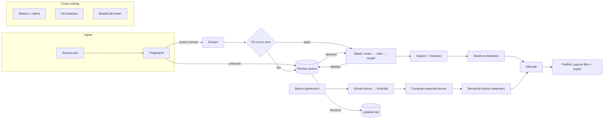

# Payout Verification for Agency Networks: Design Doc

Status: Draft v0.2, 2026-10-28. Milestone 1 implemented; see the README for what runs today. Author: Jose Guillen.
Reviewers: AlphaX engineering (architecture review).

---

## 1. Context

Affordable American Insurance (AAI) is a P&C agency network: about 100 independent agencies in 40
states, 50+ carrier appointments, 20+ carrier profit-sharing programs, EZLynx as the agency
management system (AMS). AAI's value to its agencies is carrier access and better economics:
"enhanced commission" and "profit-sharing."

That means AAI's finance team has to answer one question each month, for every carrier and every
agency: **did we get paid what we were owed, and did we pay each agency its share?**

Today the inputs to that answer arrive as:

- **Commission statements.** Each carrier sends one per period in its own format (CSV, XLSX, PDF,
  portal export), with its own column names, policy number conventions, transaction codes and
  reversal semantics.
- **Profit-sharing (contingent bonus) statements.** These come once or a few times a year. Each
  is governed by a bespoke agreement with thresholds, growth tiers, loss-ratio bands and
  eligibility rules.
- **The policy book.** This is the system of record, an AMS export: policy, carrier, line of
  business, effective date, premium, agency, producer.
- **Rate cards and split tables.** These say what each carrier should pay by line and new vs
  renewal, and what share each agency gets.

Vendors (Applied Recon, Vertafore's Reconciliation Agent, Ascend) sell statement-to-AMS matching
for a single agency. This system sits one level up, at the network. It verifies carrier payments
against expected amounts, verifies contingent bonuses against the agreement terms, and allocates
to agencies. No vendor covers the bonus verification at all.

## 2. Goals and non-goals

### Goals

1. **Verify carrier commission payments.** For each carrier statement, produce a matched,
   variance-coded reconciliation against the policy book and rate card.
2. **Verify profit-sharing payments.** For each bonus program, extract the agreement terms into
   rules, compute the expected bonus, and reconcile it against the carrier's bonus statement.
3. **Allocate to agencies.** Produce a per-agency payout file in which every cent traces back to
   source lines.
4. **Keep humans in charge of anything uncertain.** Low-confidence items go to a review queue with
   evidence. Human decisions are recorded and feed the eval set.
5. **Detect when it stops working or quietly regresses,** per counterparty, before money moves.
6. **Onboard a new counterparty or a new tenant through config and labeled examples, not code.**
7. **Run the same codebase in two profiles:** `demo`, which is fully local, deterministic and
   needs no secrets, and `prod`, which uses real infrastructure adapters.

### Non-goals (v1)

- Moving money. The output is a payout file and a report. Payment execution stays in AAI's
  accounting system.
- Replacing the AMS or writing back into EZLynx. The system reads from the AMS; a writer adapter
  is a later step.
- OCR of scanned images. v1 handles text PDFs; scanned input is rejected to the review queue.
- Real-time processing. This is a periodic batch close, and latency is measured in minutes.
- A general-purpose UI. There is one review page and file outputs.
- Multi-user auth and roles beyond a single operator identity in the demo.

## 3. Assumptions and open questions

| #   | Assumption                                                                    | If wrong                                                                                                                                                                                                                           |
| --- | ----------------------------------------------------------------------------- | ---------------------------------------------------------------------------------------------------------------------------------------------------------------------------------------------------------------------------------- |
| A1  | Carriers remit commission to AAI centrally, and AAI pays agencies.            | The statement stage still verifies the agency-level statements AAI collects. The allocation stage becomes override settlement instead. The bonus stage is unchanged. The design holds either way; only the stage emphasis changes. |
| A2  | AAI holds or can obtain an AMS policy export per agency.                      | We need a per-agency AMS adapter. The port already exists (section 6.2).                                                                                                                                                           |
| A3  | Rate cards and bonus agreements are available as documents AAI already holds. | The bonus stage needs the agreement terms entered by hand. The extraction step becomes optional.                                                                                                                                   |
| A4  | No accounting-automation vendor is already in place.                          | Scope narrows to bonus verification and allocation, positioned above the vendor.                                                                                                                                                   |

Open questions for AAI are tracked in `case-study-decision.md` section 5.

## 4. Requirements

### Functional

- **F1. Ingest** statements from a source location. Any one statement is processed once,
  whatever duplicates arrive.
- **F2. Identify** the counterparty and format of each statement by fingerprint, not by filename.
- **F3. Extract** lines to a canonical schema, with field-level confidence and a pointer to the
  source location of each value (page, row).
- **F4. Tie out.** The sum of extracted lines must equal the statement's stated total to the
  cent, or the statement is held.
- **F5. Match** each line to a policy: deterministically first, then model-assisted for the
  residue, with abstention below a threshold.
- **F6. Compute** the expected amount from effective-dated rate rules. Classify each variance by
  reason code.
- **F7. Detect absences:** policies due for commission in the period with no line on any
  statement.
- **F8. Extract** bonus agreement terms into a typed rule set. Compute the expected bonus and
  reconcile it.
- **F9. Allocate** to agencies via effective-dated split rules. Emit a payout file.
- **F10. Run a review queue** with accept, override, reassign and hold actions. Every action is
  audited and exported as a labeled example.
- **F11. Provide a kill switch** per counterparty and per tenant.

### Non-functional

- **Correctness over automation.** A wrong auto-match is worse than an exception. The system is
  biased toward abstaining.
- **Determinism.** Given the same inputs, configs and recorded model responses, a run produces
  identical outputs. Money math never touches the model.
- **Auditability.** Every output figure links to its source line, the rule version and the
  decision (code, model or human) that produced it. Runs are immutable.
- **Idempotency.** Every stage can be re-run safely, and re-running a period produces a new run
  rather than mutating the old one.
- **Isolation.** Tenants never share rows, configs or model context.
- **Cost visibility.** Every model call is metered: tokens, cost, latency, stage, counterparty.
- **Operability.** One command starts the demo. Every alert has a named owner and an action in
  the runbook.

## 5. Domain model

```
Tenant ─┬─ Counterparty (carrier | retailer | payer) ── SourceFormat (fingerprint, mapping, version)
        ├─ RecordSet (system of record: policies | invoices)
        ├─ RateRule (counterparty, product, new/renewal, rate, effective_from/to)
        ├─ SplitRule (agency, product, share, effective_from/to)
        └─ BonusProgram ── BonusAgreement (document) ── BonusRuleSet (extracted, versioned)

Run (tenant, period, profile, config_hash, status)
 └─ Statement (counterparty, format, period, stated_total, status: received|held|extracted|tied|matched|closed)
     └─ StatementLine (raw, canonical fields, confidence, source_ref)
         └─ Match (line → record, method: exact|rule|model|human, score, reasoning)
             └─ Expectation (expected_cents, rule_id@version)
                 └─ Variance (delta_cents, reason_code)

ReviewItem (subject, reason, evidence, status) ── Decision (actor, action, before/after, ts)
Allocation (agency, source lines, amount_cents) ── PayoutFile (run, agency, total, checksum)
ModelCall (stage, model, prompt_version, tokens, cost, latency, cache_hit)
```

Money is stored as integer cents (`bigint`). Rates are stored as basis points or exact decimal
strings and are never floats.

## 6. Architecture

### 6.1 Shape: a modular monolith running a staged batch pipeline



Each stage:

- reads its inputs from Postgres and writes its outputs to Postgres in one transaction;
- is keyed by `(run_id, statement_id, stage)`, which makes it idempotent;
- is scheduled as a job on a Postgres-backed queue (pg-boss), so retries, backoff and
  concurrency limits per counterparty come from one place;
- checks the kill switch before doing work.

**Why a monolith.** One team, one deploy, one database, transactional consistency between stages.
Services would add network failure modes and buy nothing at this volume: hundreds of statements a
month. The stage boundaries are the seams to split along later if volume demands it.

**Why batch.** The business process is a periodic close. A batch run gives an immutable, auditable
unit (`Run`) that can be diffed against the previous run.

### 6.2 Ports and adapters: one codebase, two profiles

All I/O goes through interfaces. The profile selects the adapters at startup, so the domain code
cannot tell demo from prod.

| Port                                    | Demo adapter                                                                                                                            | Prod adapter                                       |
| --------------------------------------- | --------------------------------------------------------------------------------------------------------------------------------------- | -------------------------------------------------- |
| `SourceStore` (where statements arrive) | Local folder watcher (`./inbox`)                                                                                                        | S3 bucket with event notification, or IMAP mailbox |
| `RecordStore` (system of record)        | Postgres seeded by the generator                                                                                                        | EZLynx export via SFTP or API, nightly snapshot    |
| `ModelClient`                           | Claude API with a **record/replay cassette**: live when a key is present and records responses; replays recorded responses when offline | Claude API, with retries, timeouts, budget guard   |
| `Clock`                                 | Fixed or controllable clock (period close on demand)                                                                                    | System clock                                       |
| `Notifier`                              | Console plus `./alerts.log` plus the review page banner                                                                                 | Slack or PagerDuty, routed by alert owner          |
| `BlobStore` (originals, outputs)        | Local `./data`                                                                                                                          | S3 with object lock for originals                  |
| `SecretStore`                           | `.env` (no secrets needed in replay mode)                                                                                               | Cloud secrets manager                              |
| `Publisher` (payout files)              | `./out/<run>/`                                                                                                                          | S3 plus an accounting-system import drop           |

**The demo is still production code.** The same migrations, the same job queue, the same stages
and the same evals run in both profiles. Only adapters differ, and each adapter has a contract
test that both implementations pass.

Record/replay makes the Loom deterministic and lets a reviewer run the demo without an API key.
CI runs the evals live, against the real model, on a schedule and on every prompt change.

### 6.3 Where the model is used, and where it is not

| Step                                         | Model?    | Why                                                                                                                     |
| -------------------------------------------- | --------- | ----------------------------------------------------------------------------------------------------------------------- |
| Format fingerprint                           | No        | Header hash plus column set plus page layout signature. Deterministic, and drift detection depends on it.               |
| CSV and XLSX extraction for a known format   | No        | A versioned column mapping in config.                                                                                   |
| Mapping proposal for a new or drifted format | Yes       | Proposes a column mapping; a human approves it and it becomes config. The model never maps silently in a run.           |
| PDF table extraction                         | Yes       | PDF goes directly to the model with a strict tool schema. The output must pass tie-out.                                 |
| Matching, exact and rules                    | No        | Normalized policy number, insured name plus effective date, premium tolerance.                                          |
| Matching, residue                            | Yes       | Ranks candidate policies, returns a score and reasoning. Abstains below the floor. Never sees money totals.             |
| Expected amounts, variances, allocation      | **Never** | Pure functions over integer cents and versioned rules.                                                                  |
| Bonus agreement to rule set                  | Yes       | Extracts to a closed typed schema (thresholds, tiers, bands, eligibility). A human approves each rule-set version once. |
| Bonus computation                            | **Never** | A deterministic evaluator over the approved rule set.                                                                   |

Model outputs use forced tool use against closed schemas, with no free-form maps. Every call
records its prompt version, model ID, tokens, cost and latency. The model is configurable per
stage; the extraction default is a cost-efficient model, and residue matching can use a stronger
one.

### 6.4 Data flow for one statement

1. A file lands in `SourceStore`. The original is stored immutably with a content hash; a
   duplicate hash is a no-op.
2. **Fingerprint** matches a known `SourceFormat@version`. A new header set or a confidence drop
   holds the statement and opens a review item with a model-proposed mapping.
3. **Extract** produces lines with a `source_ref` and per-field confidence.
4. **Tie-out**: the sum of lines must equal the stated total, or the statement is held. This
   single check catches most extraction errors.
5. **Match** runs exact, then rules, then the model on the residue. The method mix is recorded
   for each statement.
6. **Expect** computes expected cents from the effective-dated rate rule. Variances get reason
   codes: `RATE`, `PREMIUM`, `PERIOD`, `DUPLICATE`, `REVERSAL`, `UNKNOWN`.
7. **Absence**: policies due in the period with no line become `MISSING_COMMISSION` items.
8. **Allocate** writes an allocation per agency per line.
9. **Publish**: the payout file per agency plus the run report. Publishing is blocked while
   blocking review items remain open, unless an operator overrides with a reason.

### 6.5 Bonus verification

1. The bonus agreement document is extracted into a `BonusRuleSet` draft: thresholds, growth
   tiers, loss-ratio bands, eligibility exclusions, payment timing, each with a clause reference.
2. A human approves the draft, and it becomes an immutable version.
3. The evaluator computes the expected bonus from production and loss data for the program
   period, keeping a full computation trace.
4. The carrier's bonus statement is extracted, tied out and reconciled. Each variance names the
   rule and the clause that drives it.
5. The bonus is allocated to agencies per program terms.

## 7. Correctness controls

- **Tie-out to the cent** at the statement level and again at run level: total in equals total
  allocated plus retained plus held.
- **Integer cents, effective-dated rules, and a config hash** recorded on every run.
- **Immutable runs.** Re-processing creates a new run, and `run diff` shows what changed and why.
- **Abstention floor** on every model-assisted decision, tuned against the eval set and versioned
  with it.
- **Sampled audit.** A random 5% of auto-matched lines are routed to review. This catches the
  confident false match that the exception queue never sees.
- **Four-eyes on config.** New format mappings and new bonus rule sets need explicit approval
  before they take effect.

## 8. Human in the loop

The review queue is one table plus one server-rendered page. Each item shows the source excerpt,
the candidate decision, the model's reasoning and confidence, and the rule involved. The
available actions are accept, override (choose a record or amount), hold and reassign.

Every decision:

- is written to an append-only audit log;
- unblocks the downstream stage for that item;
- is exported as a labeled example with its source, so overrides become regression tests.

**Override rate per counterparty is the production accuracy signal.** Production has no labels,
and human decisions are the only labels production generates.

## 9. Observability, regression detection, kill switches

There are two different failures to detect:

- **Stopped:** the pipeline errors. This is easy, and any job monitor catches it.
- **Regressed:** the pipeline runs and is quietly wrong. This is the one that costs money, and
  most of the design is aimed at it.

| Signal                                          | Detects                                                | Threshold (initial, tuned with ops)            | Action                                                | Owner       |
| ----------------------------------------------- | ------------------------------------------------------ | ---------------------------------------------- | ----------------------------------------------------- | ----------- |
| New or changed header fingerprint               | Format drift                                           | Any                                            | Hold that counterparty's statement, propose a mapping | Finance ops |
| Extraction confidence distribution per format   | Silent extraction decay                                | p10 drops more than 0.1 vs trailing 3 runs     | Hold, alert                                           | Engineering |
| Tie-out failure                                 | Extraction error                                       | Any                                            | Hold statement                                        | Finance ops |
| Line count vs trailing average                  | Truncated or duplicated input                          | More than ±40%                                 | Warn, require ack to publish                          | Finance ops |
| Match method mix (exact, rules, model, abstain) | Upstream ID format change, model drift                 | Model share up more than 15 pts                | Alert                                                 | Engineering |
| Exception share per counterparty                | Both over- and under-matching                          | Outside the control band, **either direction** | Alert                                                 | Engineering |
| Unexplained variance $ per counterparty         | Real underpayment or a logic bug                       | Control chart, 3σ                              | Alert, attach top lines                               | Finance ops |
| Silent counterparty                             | Missing statement                                      | No statement by cadence plus 5 days            | Alert                                                 | Finance ops |
| Override rate per counterparty                  | Production accuracy decay                              | More than 2x trailing                          | Alert, add the overrides to the eval set              | Engineering |
| Golden replay (canary)                          | Model or provider regression, separate from data drift | Any diff vs expected                           | Fail the run's health check                           | Engineering |
| Model cost per statement                        | Prompt bloat, retries                                  | More than 2x trailing                          | Warn                                                  | Engineering |

**Kill switches** apply per counterparty, per stage and per tenant. A killed counterparty's
statements are ingested and stored but not processed, and the run report lists them. Flipping a
switch is audited.

Metrics live in Postgres, so the history, report and demo dashboard come from one store. They are
also exposed in Prometheus format for prod scraping.

## 10. Evals and the release gate

- **Labeled set per format.** Each canonical statement has expected lines, matches and variances.
  It is seeded from the synthetic generator and grows from human overrides.
- **Held-out format.** One format is never used during development and is evaluated only in CI,
  which guards against overfitting to formats the author has seen.
- **Fault corpus.** A separate generator injects faults: renamed headers, split pages, duplicate
  lines, reversals, rounding, wrong agency codes. It is kept apart from the main generator so the
  pipeline is not built around its own faults.
- **Metrics per stage.** Extraction field accuracy and tie-out rate; match precision, recall and
  abstention rate; variance classification accuracy; bonus computation exact-match.
- **Gate.** Prompt, model, mapping or rule changes cannot merge if any stage drops below its floor
  or precision drops at all. Cost and latency deltas are reported on the PR.
- **Two modes.** Replay mode runs in milliseconds on every push. Live mode runs nightly and on
  prompt or model changes.

## 11. Multi-tenancy and the second company

A tenant is a directory of config plus a labeled set, with no code:

```
tenants/
  aai/
    tenant.yaml            # products, periods, cadence, thresholds, owners
    counterparties/*.yaml  # fingerprint, mapping@version, cadence, kill switch default
    rates/*.csv            # effective-dated rate rules
    splits/*.csv
    bonus/*.pdf → rulesets/*.json (approved)
    labels/
  consumer-brand-demo/     # retailer deductions
    tenant.yaml
    counterparties/retailer-a.yaml
    labels/
```

**The retailer deductions mapping** (shaped like Performance Beauty Group, RIP-IT or Soleil):

| Insurance concept            | Retail concept                                        |
| ---------------------------- | ----------------------------------------------------- |
| Carrier commission statement | Retailer remittance advice and debit memo             |
| Policy book                  | Invoices, POs and ASNs from the ERP                   |
| Rate card                    | Trade terms and promo agreements                      |
| Commission variance          | Deduction, classified valid or invalid by reason code |
| Bonus program                | Promo accrual vs retailer claim                       |
| Payout to agency             | Dispute packet and recovery                           |

**What does not port, and is said out loud:** the system-of-record adapter, the matching keys,
the reason-code taxonomy, the labeled set (which has to be rebuilt with that company's
operators), the data agreement, and who owns the code at exit.

**Tenant isolation.** Every table carries `tenant_id` with Postgres row-level security. Model
calls never mix tenants in one context, and each tenant has its own model budget.

## 12. Security and data handling

- **Synthetic data only** in the repo and the demo, with invented carriers, rates and agencies.
- **PII.** Insured names and policy numbers count as PII in prod. Logs carry IDs, not values, and
  model prompts get the minimum fields needed. There is a retention policy per tenant.
- **Originals** are stored with a content hash and object lock in prod.
- **Audit log** is append-only and covers every decision, config change, kill switch flip and
  publish.
- **Secrets** come from a secrets manager in prod. The demo needs none in replay mode.

## 13. Failure modes

| Failure                                        | Behavior                                                                                                                       |
| ---------------------------------------------- | ------------------------------------------------------------------------------------------------------------------------------ |
| Model API down or slow                         | Retries with backoff and a per-call timeout. The stage is marked `waiting_model`; the run continues for deterministic formats. |
| Model returns invalid schema                   | Rejected by the schema, retried once, then sent to review. Never coerced.                                                      |
| Statement for unknown period or counterparty   | Held, review item created.                                                                                                     |
| Rate rule missing for a product or date        | Line marked `NO_RULE` and sent to review. No expected amount is guessed.                                                       |
| Duplicate statement (same content)             | No-op by hash.                                                                                                                 |
| Corrected statement (same period, new content) | New statement version. Earlier allocations are superseded in a new run, and the diff is shown.                                 |
| Partial run crash                              | Jobs are idempotent per stage. Resume picks up where it stopped.                                                               |
| Budget exceeded                                | Model stages pause for that tenant, deterministic stages continue, alert sent.                                                 |

## 14. Alternatives considered

| Option                                                      | Why not (for v1)                                                                                                                            |
| ----------------------------------------------------------- | ------------------------------------------------------------------------------------------------------------------------------------------- |
| Buy agency-level reconciliation (Ascend, Applied Recon)     | Solves single-agency matching, not network allocation or bonus verification. It can be a `SourceStore` or `RecordStore` adapter later.      |
| End-to-end LLM ("read statements, tell me what we're owed") | Not auditable, not deterministic, and money math by a model fails every control in section 7.                                               |
| Rules only, no model                                        | Breaks on PDFs, new formats and fuzzy matches, which is where the hours go today. The model handles the residue, and rules handle the rest. |
| Microservices per stage                                     | Network failure modes and ops cost with no volume reason. Stage boundaries keep the option open.                                            |
| Streaming or event sourcing                                 | The domain is a periodic close. Immutable runs give the auditability without the complexity.                                                |
| Workflow engine (Temporal)                                  | Good fit at scale, but too heavy for v1. pg-boss gives retries and idempotency on the database we already run.                              |

## 15. Stack

TypeScript (Node 22), Postgres 16, pg-boss (jobs), Kysely (SQL, typed, no ORM magic), Zod (schemas
at every boundary), Anthropic SDK (tool use, prompt caching), Hono (review page, health and
metrics endpoints), Vitest (unit, contract and eval runner), Docker Compose (demo), GitHub Actions
(CI, eval gate).

## 16. Repo layout

```
src/
  domain/        # pure: types, money, rules evaluator, matching, variance, allocation
  pipeline/      # stages, job wiring, run orchestration
  ports/         # interfaces
  adapters/      # demo/* and prod/* per port
  model/         # prompts (versioned), schemas, client, cassette
  review/        # queue service + page
  observability/ # metrics, alerts, kill switches
  cli/           # run, replay, diff, approve-mapping, approve-ruleset, kill
tenants/         # config + labels per tenant
synthetic/       # world generator, format renderers, fault generator (separate)
evals/           # harness, floors, reports
migrations/
docs/            # design.md, runbook.md, adr/
```

## 17. Demo profile: what a reviewer runs

```
docker compose up               # postgres + app, profile=demo, replay mode
pnpm demo:seed                  # synthetic world + three statement formats for period 2026-09
pnpm demo:run --period 2026-09  # full pipeline; outputs in ./out/<run>/
open http://localhost:3000      # review queue, run report, metrics
pnpm demo:break carrier-c       # renames a column in carrier C's next statement
pnpm demo:run --period 2026-10  # fingerprint trips, carrier C held, alert fires, others close
pnpm eval                       # replay evals; held-out format; floors
```

## 18. Milestones and cut line

Each item is a hard stop: if time runs out, ship everything above it and say so.

1. Domain core: money, rules, matching, variance, allocation, with unit tests. Synthetic world
   with three formats. Demo adapters.
2. Pipeline stages on pg-boss, tie-out, review queue, audit log, run report, payout files.
3. Evals: labeled sets, fault corpus, held-out format, CI gate, cassette replay.
4. Observability: fingerprint drift, control charts, silent counterparty, kill switches, alert
   routing.
5. Bonus stage: one agreement into a rule set, the evaluator, the reconciliation.
6. Second tenant: retailer deductions config plus labels, with no code changes.
7. Prod adapters (S3, Slack): implemented against contract tests, not deployed.
8. Runbook and ADRs.

## 19. Review questions for the architecture reviewer

- Are integer cents plus effective-dated rules plus immutable runs enough auditability for a
  finance close, or do we want a full double-entry ledger?
- Is the abstention floor per stage, or per stage and counterparty?
- Is it acceptable to block publishing on open blocking items, or does finance need a partial
  publish?
- Postgres row-level security vs schema-per-tenant for the portfolio-wide deployment model?
